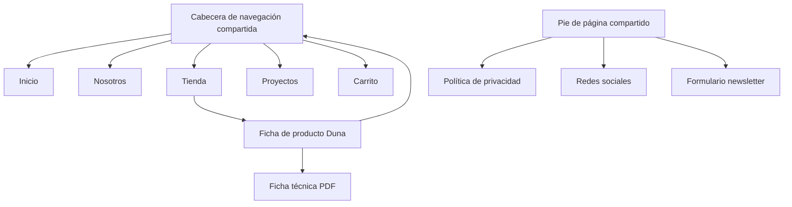
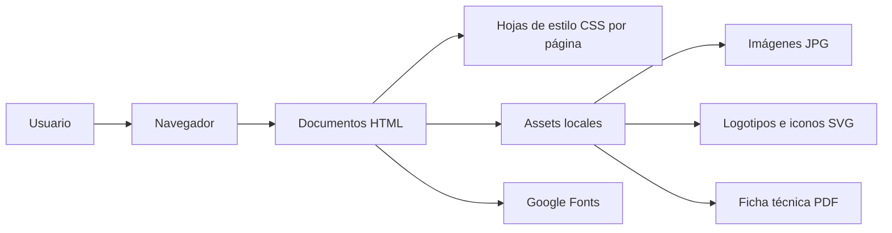

# AttikStudio — PEC04

**Una nueva mirada al diseño**

Proyecto académico de desarrollo web de un estudio de diseño de mobiliario. AttikStudio presenta su identidad, filosofía, equipo, proyectos de interiorismo y catálogo de piezas mediante una web corporativa con una propuesta visual coherente.

**Autor:** Thomas Eicher · **Actividad:** PEC04

## Objetivos

- Crear una web multipágina con HTML y CSS.
- Aplicar una identidad visual consistente a todas las páginas.
- Organizar el contenido mediante etiquetas semánticas y una nomenclatura de clases inspirada en SUIT CSS.
- Presentar productos, proyectos y vías de contacto de forma clara.
- Aplicar técnicas de diseño adaptable y optimización de imágenes.

## Tecnologías utilizadas

| Tecnología | Aplicación |
| --- | --- |
| HTML5 | Estructura, navegación, contenido y formularios. |
| CSS3 | Estilos, variables, CSS nesting, Grid, Flexbox y media queries. |
| Google Fonts | Space Grotesk y Special Gothic. |
| SVG, JPG y PDF | Identidad gráfica, fotografías, iconos y ficha técnica. |
| Git | Control de versiones. |
| Mermaid | Documentación visual de la arquitectura y navegación. |

## Estructura del proyecto

```text
pec04/
├── index.html
├── nosotros.html
├── tienda.html
├── duna.html
├── proyectos.html
├── carrito.html
├── politica-de-privacidad.html
├── css/
│   ├── index.css
│   ├── nosotros.css
│   ├── tienda.css
│   ├── duna.css
│   ├── proyectos.css
│   └── carrito.css
├── assets/
│   └── Recursos gráficos y ficha técnica Duna (PDF)
├── .gitattributes
└── README.md
```

## Páginas y contenidos

| Página | Contenido |
| --- | --- |
| Inicio | Presentación del estudio, filosofía, equipo y contacto. |
| Nosotros | Geometría esencial, diseño sensorial, nuevas perspectivas, clientes y contacto. |
| Tienda | Catálogo de nueve piezas, precios, muestras de color e interfaz de filtro. |
| Duna | Detalle de producto, ficha técnica descargable y piezas relacionadas. |
| Proyectos | Hotel Bruma, Casa Oliva y Ristorante Lume. |
| Carrito | Selección de piezas y formulario de solicitud. |
| Política de privacidad | Archivo reservado, actualmente vacío. |

## Mapa de navegación



La cabecera permite acceder a las secciones principales desde las seis páginas desarrolladas. La tienda enlaza con la ficha de Duna, desde la cual se puede abrir el PDF técnico.

## Arquitectura web



La arquitectura es estática y no requiere un framework ni un proceso de compilación. Cada página dispone de su propia hoja de estilos.

## Identidad visual

| Color | Código |
| --- | --- |
| Burdeos | `#780000` |
| Verde menta | `#E0EEE6` |
| Verde salvia | `#A8CEB9` |

La propuesta combina geometría, líneas divisorias, composición modular y fotografías de mobiliario. Special Gothic se utiliza en los encabezados y Space Grotesk en los textos y elementos de interfaz.

## Metodología CSS

La nomenclatura se inspira en SUIT CSS, diferenciando componentes, descendientes y modificadores:

```css
.Header {}
.Header-nav {}
.Header-aLeft--bold {}
```

Se utilizan variables CSS para centralizar los colores y bordes, Grid para las composiciones principales y Flexbox para la alineación interna. El proyecto emplea unidades relativas como `rem`, `vw`, `fr`, `%` y `px`. La función `clamp()` permite ajustar tamaños tipográficos de forma fluida.

Las hojas de estilo incluyen una media query a 1200 px para adaptar la navegación y mostrar el icono de menú hamburguesa.

## Accesibilidad y rendimiento

- Uso de elementos semánticos y jerarquías de encabezados.
- Textos alternativos en imágenes y atributos ARIA en el botón de navegación.
- Carga diferida mediante `loading="lazy"` en numerosas imágenes.
- Tipografía fluida y uso de unidades relativas.

Estas medidas son parte de la implementación; no constituyen una certificación de accesibilidad ni una auditoría completa de rendimiento.

## Autoría

Thomas Eicher — PEC04. Proyecto académico AttikStudio.
